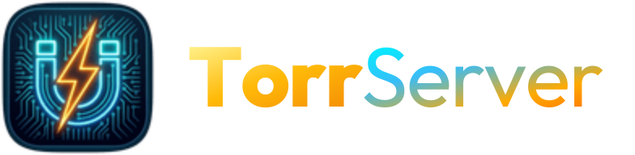

<p align="center">
  <picture>
    <source media="(prefers-color-scheme: dark)" srcset="docs/assets/logo-dark.png">
    <source media="(prefers-color-scheme: light)" srcset="docs/assets/logo-light.png">
    
  </picture>
</p>

<p align="center">
  Simple and powerful tool for streaming torrents.
  <br/>
  <br/>
  <a href="https://github.com/lampac-nextgen/TorrServer/actions/workflows/ci.yml">
    
  </a>
  <a href="https://github.com/lampac-nextgen/TorrServer/releases">
    
  </a>
  <a href="https://github.com/lampac-nextgen/TorrServer/tags">
    
  </a>
  <a href="https://go.dev/">
    
  </a>
  <a href="https://www.typescriptlang.org/">
    
  </a>
  <a href="https://react.dev/">
    
  </a>
  <a href="https://github.com/lampac-nextgen/TorrServer/blob/master/LICENSE">
    
  </a>
  <a href="https://github.com/lampac-nextgen/TorrServer/pkgs/container/torrserver">
    
  </a>
  <br/>
  <a href="https://github.com/lampac-nextgen/TorrServer/stargazers">
    
  </a>
  <a href="https://github.com/lampac-nextgen/TorrServer/forks">
    
  </a>
  <a href="https://github.com/lampac-nextgen/TorrServer/issues">
    
  </a>
  <a href="https://github.com/lampac-nextgen/TorrServer/pulls">
    
  </a>
  <a href="https://github.com/lampac-nextgen/TorrServer/commits/master">
    
  </a>
  <a href="https://t.me/LampacTalks">
    
  </a>
</p>


## Introduction

TorrServer is a program that allows users to view torrents online without the need for preliminary file downloading.
The core functionality of TorrServer includes caching torrents and subsequent data transfer via the HTTP protocol,
allowing the cache size to be adjusted according to the system parameters and the user's internet connection speed.

## AI Documentation

[](https://deepwiki.com/lampac-nextgen/TorrServer)

## Features

- Caching
- Streaming
- Local and Remote Server
- Viewing torrents on various devices
- Integration with other apps through [API](docs/api.md)
- [Torznab](docs/torznab.md) search (Jackett, Prowlarr, and similar indexer managers)
- Cross-browser modern web interface
- Optional DLNA server
- Optional [GStreamer](docs/gstreamer.md) HLS remuxing and transcoding (`-gst` builds from release 141.10)
- Native [MCP](server/mcp/README.md) server for AI agents (OpenClaw, Hermes, and other MCP clients)
- [External subtitles](docs/subtitles.md) (SRT/ASS/SSA/VTT to WebVTT) for web players and external players

## Quick start

Linux (interactive installer, systemd service):

```bash
curl -fsSL https://raw.githubusercontent.com/lampac-nextgen/TorrServer/master/installTorrServerLinux.sh -o installTorrServerLinux.sh && chmod 755 installTorrServerLinux.sh && sudo bash ./installTorrServerLinux.sh
```

Docker:

```bash
docker run --rm -d --name torrserver -p 8090:8090 ghcr.io/lampac-nextgen/torrserver:latest
```

Windows, macOS, NAS and others: download the binary for your platform from the [releases](https://github.com/lampac-nextgen/TorrServer/releases) page and run it.

Then open <http://127.0.0.1:8090> in a browser. [Installation](docs/installation.md) covers every platform and the installer's options.

## Documentation

| Topic | What is in it |
|---|---|
| [Installation](docs/installation.md) | Windows, Linux installer script, macOS, IOCage, NAS |
| [Docker](docs/docker.md) | `docker run`, environment variables, Compose |
| [Server arguments](docs/cli.md) | Command-line flags |
| [HTTPS](docs/https.md) | Modes, certificates, Let's Encrypt on a LAN, Android TV box |
| [Reverse proxy](docs/reverse-proxy.md) | Caddy and nginx in front of TorrServer |
| [Authentication](docs/auth.md) | HTTP Basic auth and `accs.db` |
| [Web Application Firewall](docs/waf.md) | IP and Referer/Origin rules |
| [Retrackers](docs/retrackers.md) | Adding trackers to torrents |
| [Memory use](docs/memory.md) | Reading memory numbers on Linux, `--pprof` |
| [Torznab](docs/torznab.md) | Jackett and Prowlarr search |
| [GStreamer](docs/gstreamer.md) | HLS remux and transcoding builds |
| [API](docs/api.md) | HTTP API and Swagger |
| [MCP](server/mcp/README.md) | Tools for AI agents |
| [Telegram bot](server/tgbot/README.md) | Bot setup and commands |
| [External subtitles](docs/subtitles.md) | Supported formats and layouts |
| [Smart TV](docs/smart-tv.md) | Media Station X |
| [Development](docs/development.md) | Running from source, web UI, building, [BUILD.md](docs/BUILD.md) |
| [Credits and support](docs/credits.md) | Donate, thanks |

The same list with more detail is in [docs/README.md](docs/README.md).
